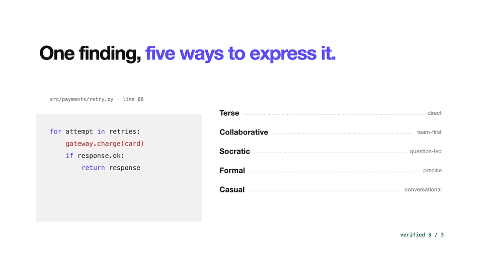
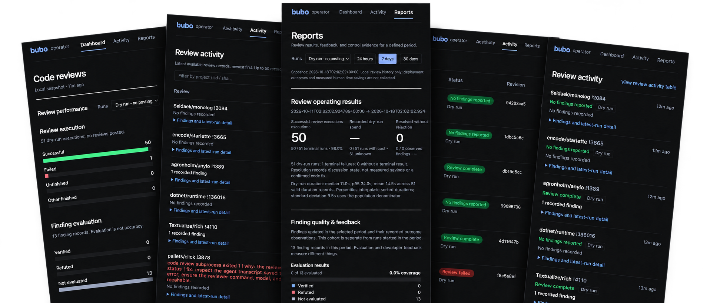

# Bubo 🦉

[](https://pypi.org/project/bubo/)
[](https://github.com/mountainowl/bubo/blob/main/pyproject.toml)
[](https://github.com/mountainowl/bubo/pkgs/container/bubo)
[](https://mountainowl.github.io/bubo/github-action/)
[](https://github.com/mountainowl/bubo/actions/workflows/ci.yml)
[](https://mountainowl.github.io/bubo/features/)
[](https://mountainowl.github.io/bubo/telemetry/)
[](https://scorecard.dev/viewer/?uri=github.com/mountainowl/bubo)
[](https://github.com/mountainowl/bubo/releases)
[](https://slsa.dev)
[](https://github.com/astral-sh/ruff)
[](https://github.com/astral-sh/uv)
[](https://mountainowl.github.io/bubo/)
[](https://github.com/mountainowl/bubo/blob/main/LICENSE)



This wise owl is **Bubo**, an **agentic AI code reviewer** that reviews your GitLab
MRs and GitHub PRs with the LLM model _of your choice_, and posts only the findings worth
acting on as inline threads — no chatbot noise, no praise, no summaries.

- **Signal over noise** — evidence-backed inline findings, confidence gates, optional verification, and deduplication.
- **Your model, your infrastructure** — OpenAI, Anthropic, or another CLI-backed reviewer with your own deployment.
- **Feedback-driven reviews** — recorded outcomes help tune thresholds and suppress recurring unwanted findings.
- **Review evidence, in one place** — local dashboards and reports for findings, usage, policy decisions, and outcomes.
- **Compliance** - cosign-signed releases with SBOMs, auditable on-prem report
- **Metrics and RoI** — [Read about real world metrics and ROI](https://mountainowl.github.io/bubo/operate/#governance-report)

> Run continuous reviews through [polling](https://mountainowl.github.io/bubo/recipes/),
> or trigger reviews through [MCP](https://mountainowl.github.io/bubo/mcp/). The experimental
> [GitHub Action](https://mountainowl.github.io/bubo/github-action/).



## Install

```sh
uv tool install bubo     # or: pipx install bubo
bubo init                # idempotent; seeds config + workspace + DB
bubo doctor              # verify before the first poll
bubo-poller service start # start the review service (polling + outcome sync)
```

Container → `docker pull ghcr.io/mountainowl/bubo` - Bring your own LLM CLI, you can use multiple architectures.

## Documentation

Everything lives on the docs site — this README is just the front door.

|                                                                        |                                                        |
| ---------------------------------------------------------------------- | ------------------------------------------------------ |
| [Recipes](https://mountainowl.github.io/bubo/recipes/)                 | Copy-paste GitLab / GitHub / in-house-model setups.    |
| [Features](https://mountainowl.github.io/bubo/features/)               | The full capability list.                              |
| [Configuration](https://mountainowl.github.io/bubo/configuration/)     | Every setting, per section, plus a quick-start config. |
| [Operate](https://mountainowl.github.io/bubo/operate/)                 | Deploy, schedule, grade outcomes, governance report.   |
| [Troubleshooting](https://mountainowl.github.io/bubo/troubleshooting/) | Host / infra fixes (sandbox, AppArmor).                |
| [Metrics & telemetry](https://mountainowl.github.io/bubo/telemetry/)   | Emitted `llm_review.*` metrics and dashboards.         |
| [Updates & recovery](docs/pages/auto-update.mdx)                       | Automatic/manual updates, safe deferrals and issue-ready failure reports; platform acceptance status. |

## Community

[Contributing](CONTRIBUTING.md) · [Security policy](SECURITY.md) · [Release verification](https://mountainowl.github.io/bubo/operate/#verify-a-release) · [Support](SUPPORT.md) · [Code of conduct](CODE_OF_CONDUCT.md) · [License: MIT](LICENSE)
